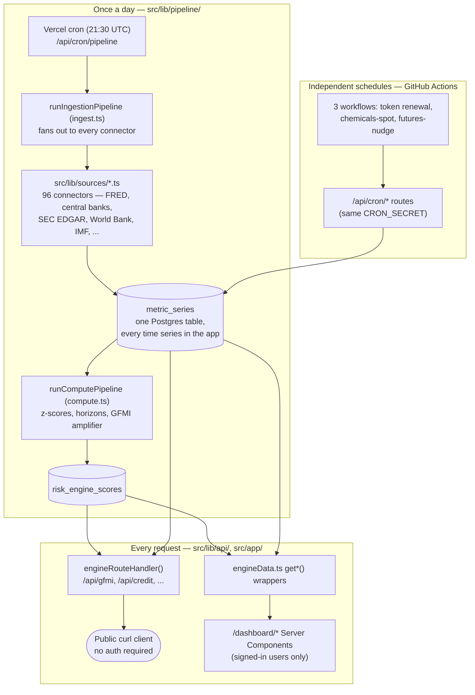

# Architecture

A newcomer-oriented tour of how data moves through this app, from an external API to a number on a
dashboard page. `CLAUDE.md` and `AGENTS.md` cover the same ground in more depth but are written for
an AI coding agent working in this repo, not a first-time human reader — start here instead.

## The shape of it

- **Sources → `metric_series`**: `src/lib/sources/<name>.ts` is one file per external feed, each
  exporting `fetch<Thing>(): Promise<MetricPoint[]>`. `runIngestionPipeline` (`src/lib/pipeline/ingest.ts`)
  calls all ~96 of them, every one wrapped in `withStageTimeout` so one stuck connector can't take
  the whole run down, and the daily pipeline's own 300-second serverless ceiling is treated as a hard
  constraint, not a guideline.
- **`metric_series` is the entire data layer.** Every macro indicator, commodity price, and
  engine-internal series lives in this one indexed `(metric_key, observed_at)` table — not 20+
  per-domain tables — because adding a new series should never require a schema migration. Everything
  reads and writes through `src/lib/metrics/store.ts`.
- **`metric_series` → engine scores**: once ingestion finishes, `runComputePipeline`
  (`src/lib/pipeline/compute.ts`) runs the **24 registered engines** in `src/lib/engines/registry.ts`,
  each producing a short/medium/long-horizon z-score-based read, and folds them into the one **GFMI**
  composite via a weighted average plus a nonlinear multi-shock amplifier.
- **Two ways in, one source of truth**: the **public `/api/*` routes** (`engineRouteHandler()` +
  `respond.ts`) and the **signed-in `/dashboard/*` pages** (`src/lib/api/engineData.ts`'s `get*()`
  wrappers) both read from the same `metric_series`/`risk_engine_scores` tables — there's no separate
  "public" dataset and "real" dataset. The dashboard additionally computes ~50 page-level
  domain engines (oilseeds cointegration, derivatives stress indices, geopolitical composites, etc.)
  that are **not** part of the 24-engine GFMI registry — see `CLAUDE.md`'s "Two different meanings of
  'engine'" section before assuming a file under `src/lib/engines/` feeds the composite score.
- **Auth is a single global gate**, not a per-page check: `src/lib/supabase/middleware.ts`'s
  `updateSession` requires a signed-in user on every route except an explicit allowlist
  (`/login`, `/signup`, `/auth/*`, `/api/*`, `/robots.txt`, `/sitemap.xml`) — which is *why* the public
  API demo in the README needs no key: `/api/*` was deliberately left out of the gate from the start.
- **One Vercel cron slot, three more via GitHub Actions**: Vercel's Hobby plan allows exactly one
  `vercel.json` cron entry, already spent on the daily pipeline. Anything needing a tighter or
  independent schedule (a 24h-lived broker token, a twice-daily chemicals feed) is instead triggered by
  a GitHub Actions workflow hitting its own `/api/cron/<name>` route with the same `CRON_SECRET` — see
  `.github/workflows/`.

## Where the honesty discipline actually lives in code

The project's core promise — "every number is real, or it says `UNAVAILABLE`" — isn't a README claim
with nothing behind it:

- `src/lib/metrics/stats.ts` computes every score deterministically from stored data. No LLM is in
  that path.
- `src/lib/quality/freshness.ts` classifies every value LIVE/RECENT/STALE/UNAVAILABLE against that
  specific source's real publication cadence (an annual series gets a much longer "still current"
  window than a daily one).
- Four narrow, explicitly disclosed exceptions call an LLM for user-facing text (not numbers) — see
  CLAUDE.md's "places an LLM computes something user-facing" section if you're touching one of those.

## Next places to read

- `README.md` — product framing, full engine list, country coverage, what's deliberately not built.
- `CLAUDE.md` — the dense, AI-agent-oriented version of this document, plus commands and gotchas.
- `docs/CARRY_ENGINE.md`, `docs/DERIVATIVES_ENGINE.md`, `docs/GEOPOLITICAL_ENGINE.md` — the three
  page-level analytical layers that sit beside (not inside) the 24-engine GFMI registry.
- `docs/API_EXAMPLES.md` — verified live responses from the public API shown above.
